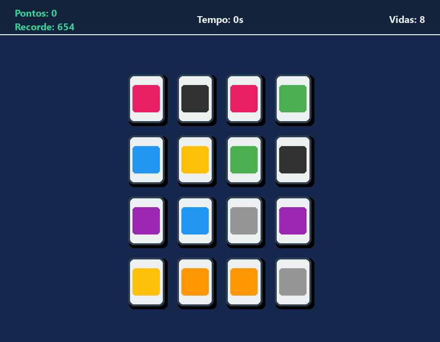
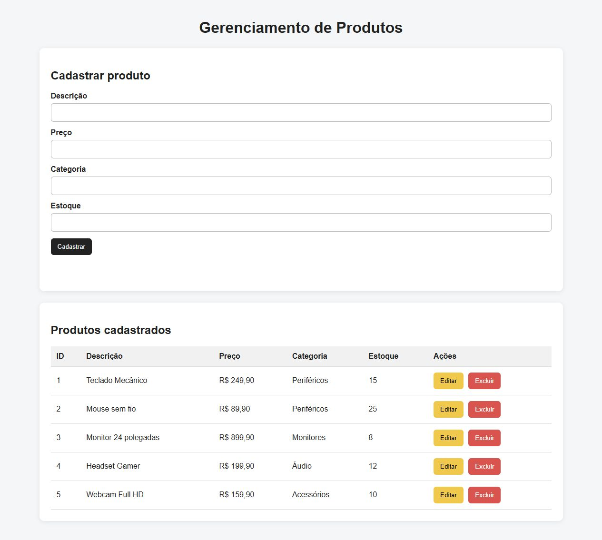
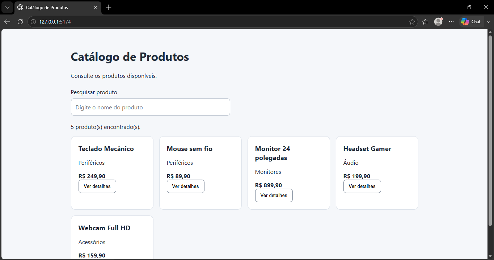

# Thiago Guerra · Portfólio Profissional


Portfólio desenvolvido para o Trabalho Prático 1 de Desenvolvimento e Integração de Aplicações Web, na PUC Minas. Reúne minha apresentação, projetos, experiências acadêmicas e contatos.

## Status do projeto

Implementação local concluída. A publicação na Vercel será feita pelo autor. O recebimento do formulário depende da ativação do endereço no FormSubmit. Consulte [a conferência da entrega](docs/ENTREGA.md) para verificar as etapas externas.

## Índice

- [Links úteis](#links-úteis)
- [Sobre o projeto](#sobre-o-projeto)
- [Funcionalidades principais](#funcionalidades-principais)
- [Tecnologias utilizadas](#tecnologias-utilizadas)
- [Arquitetura](#arquitetura)
- [Instalação e execução](#instalação-e-execução)
- [Deploy](#deploy)
- [Estrutura de pastas](#estrutura-de-pastas)
- [Demonstração](#demonstração)
- [Testes](#testes)
- [Documentações utilizadas](#documentações-utilizadas)
- [Autor](#autor)

## Links úteis

- Site publicado: **adicionar a URL fornecida pela Vercel após o deploy**.
- [Repositório do portfólio](https://github.com/thiagoguerra-199/portfolio-profissional)
- [Wireframes no Figma](https://www.figma.com/design/OmjjC7m9EzuSqgv9bxqpjr)
- [Meu GitHub](https://github.com/thiagoguerra-199)
- [Meu LinkedIn](https://www.linkedin.com/in/thiago-guerra-4282573b7/)
- [Roteiro para apresentação](docs/APRESENTACAO.md)

## Sobre o projeto

O objetivo é apresentar minha formação e os projetos que desenvolvi enquanto estudo Engenharia de Software. O visual usa fundo escuro e detalhes em roxo, seguindo a identidade do meu GitHub. O conteúdo é direto e o layout se adapta a computadores e celulares.

Os wireframes de média fidelidade estão em [desktop.svg](docs/wireframes/desktop.svg) e [mobile.svg](docs/wireframes/mobile.svg). São arquivos vetoriais editáveis que podem ser arrastados para um arquivo do Figma. Os wireframes também estão no arquivo online indicado em Links úteis. O acesso externo ao arquivo depende da configuração de compartilhamento aprovada pelo autor.

## Funcionalidades principais

- Menu com acesso a Sobre Mim, Projetos, Experiências e Contato.
- Apresentação em português e inglês, com troca pelo botão de idioma.
- Linha do tempo alimentada pelos dados de `src/data.js`, em ordem cronológica.
- Projetos com descrição, tecnologias, repositório e imagem real.
- Experiências acadêmicas com instituição, atividade, período e descrição.
- Links clicáveis para e-mail, LinkedIn e GitHub.
- Formulário com nome, e-mail e mensagem, integrado ao FormSubmit.
- Validação de campos obrigatórios, formato do e-mail e tamanho da mensagem.
- Mensagens de envio, erro e confirmação de encaminhamento.
- Menu para celular, foco de teclado e suporte a movimento reduzido.

O WhatsApp foi omitido conforme escolha do autor; os contatos usados são e-mail, GitHub e LinkedIn.

## Tecnologias utilizadas

| Tecnologia | Finalidade |
| --- | --- |
| React 19.3.1 | Componentes e estados da interface |
| React DOM 19.3.1 | Renderização da aplicação |
| Vite 7.3.8 | Servidor de desenvolvimento e build |
| JavaScript | Lógica da aplicação |
| HTML e CSS | Estrutura, estilo, responsividade e animações |
| FormSubmit | Encaminhamento das mensagens por e-mail |
| SVG | Ícones e logo locais |
| Google Fonts | Fontes DM Sans e Space Grotesk, com alternativas do sistema |

As únicas dependências npm são React, React DOM e Vite. Os ícones ficam no próprio projeto. Não foi usada uma biblioteca de componentes ou de animação.

## Arquitetura

A aplicação usa uma única página com navegação por âncoras. `App.jsx` organiza as seções, `Contact.jsx` cuida do formulário e `data.js` armazena os dados de perfil, projetos e experiências.

Não há banco de dados nem servidor próprio. Ao enviar o formulário, o navegador faz uma requisição HTTPS ao FormSubmit, que encaminha a mensagem ao e-mail do autor. Esse serviço faz o papel da integração externa de envio.

O serviço recebe nome, e-mail e mensagem somente quando o visitante envia o formulário. Nenhuma chave privada ou senha é necessária no código. Existe um campo oculto para ajudar a filtrar envios automáticos.

## Instalação e execução

### Pré-requisitos

- Node.js 22.12 ou superior.
- npm.
- Acesso à internet na primeira instalação.

### Instalação de dependências

Na pasta que contém `package.json`:

```bash
npm install
```

### Como executar a aplicação

```bash
npm run dev
```

Abra o endereço informado pelo Vite no terminal. Para gerar a versão de produção:

```bash
npm run build
npm run preview
```

O resultado do build fica em `dist/`. Não é necessário configurar variáveis de ambiente para a versão atual.

### Formulário de contato

O destinatário está em `profile.email`, dentro de `src/data.js`.

1. Abra o site por HTTP ou HTTPS, e envie uma mensagem de teste.
2. No primeiro uso, confira a caixa de entrada e o spam de `thiagoguerra199@gmail.com`.
3. Se o FormSubmit solicitar, confirme a ativação pelo link recebido.
4. Envie uma segunda mensagem e confira o recebimento antes da apresentação.

Uma resposta aceita pelo serviço não comprova, sozinha, a chegada à caixa de entrada. O recebimento real precisa ser conferido pelo dono do e-mail. Se ocorrer uma falha, os dados preenchidos permanecem no formulário e o link direto de e-mail continua disponível.

## Deploy

A publicação na Vercel será feita pelo autor.

1. Envie o conteúdo da pasta do projeto para um repositório no GitHub. Não envie `node_modules`, `.git`, `.work` ou a pasta com o ZIP.
2. Na Vercel, importe esse repositório.
3. Selecione **Vite** como Framework Preset.
4. Use `npm install` como Install Command, `npm run build` como Build Command e `dist` como Output Directory.
5. Escolha Node.js 22 ou superior e publique.
6. Copie a URL pública para a seção Links úteis deste README.
7. Confira o site em uma janela anônima e teste o formulário no domínio publicado.

Configurações equivalentes também estão no arquivo `vercel.json`. A atividade pede a URL do site: o ZIP não substitui o endereço publicado.

## Estrutura de pastas

```text
portifolio/
    docs/
        wireframes/
            desktop.svg
            mobile.svg
        APRESENTACAO.md
        ENTREGA.md
        IMAGENS.md
        TESTES.md
        template-professor.md
    public/
        projetos/
            match-memory.png
            crud-produtos.jpg
            catalogo-react.png
        favicon.svg
    src/
        components/
            Contact.jsx
            Icons.jsx
        App.jsx
        data.js
        main.jsx
        style.css
    .gitignore
    .prettierrc.json
    index.html
    package.json
    package-lock.json
    README.md
    vercel.json
    vite.config.js
```

## Demonstração







A origem de cada imagem está documentada em [IMAGENS.md](docs/IMAGENS.md). Não foram usadas imagens geradas para representar os projetos.

## Testes

A verificação usa build de produção e testes manuais dos fluxos principais. Os resultados e limites estão registrados em [TESTES.md](docs/TESTES.md).

## Documentações utilizadas

- [React](https://react.dev/)
- [Vite](https://vite.dev/)
- [FormSubmit](https://formsubmit.co/documentation)
- [Vercel](https://vercel.com/docs/frameworks/frontend/vite)
- [Template de README indicado pelo professor](https://github.com/joaopauloaramuni/desenvolvimento-e-integracao-de-aplicacoes-web/blob/main/TEMPLATES/template_README.md)

## Autor

Thiago Guerra de Araújo · Engenharia de Software · PUC Minas.

## Contribuição

Projeto acadêmico individual. Os projetos de terceiros apresentados têm seus repositórios e participantes próprios. Alterações neste portfólio podem ser discutidas por issues e pull requests após sua publicação no GitHub.

## Agradecimentos

À PUC Minas, ao professor da disciplina e aos colegas dos projetos acadêmicos apresentados.

## Licença

Não foi definida uma licença de redistribuição para este portfólio. Os projetos apresentados seguem as condições de seus respectivos repositórios.
